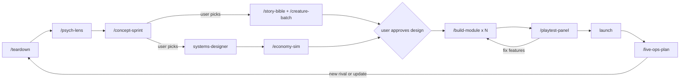

# Agent and skill framework

How an AI game studio turns research into designed, built and tested games with a team of agents, modelled on Factory's droids, skills and missions.
It is written so the same definitions run in Claude Code and in Factory Droid.

The design goal is **every agent run produces new, checkable value, or the run stops**.
Agents never talk to each other, never spawn each other, and never judge work against a bar that moved after the work started.

## 1. The layers

| Layer | Factory name | Here | What it holds |
|---|---|---|---|
| Always-on rules | `AGENTS.md` | `AGENTS.md` (imported by `CLAUDE.md`) | Studio conventions, ethics rule, model routing |
| Specialists | Droids | `.claude/agents/<name>.md`, mirrored to `.factory/droids/` | One role, one model, a tool boundary, a report schema |
| Procedures | Skills | `.claude/skills/<name>/SKILL.md`, mirrored to `.factory/skills/` | How a job runs: which mission template, which agents, which gates |
| Units of work | Missions | `missions/<nn>-<name>/` (or `games/<slug>/missions/` in a multi-game repo) | Goal, contract, feature list with state, handoffs |
| Execution | Mission Control | `.claude/workflows/mission-control.js` | The one loop that runs features, validates them and enforces budgets |
| Shared memory | Mission `library/` | A Markdown or Obsidian vault, for example `vault/` | Teardowns, psychology, pillars, decisions, known facts |

**Agents are who, skills are how, missions are what and when, the vault is what we know.**
The main session is the **Director**: it plans missions with the user, starts Mission Control, reads results, and owns the human gates.

### One source, two runtimes

guild's `crew/` and `skills/` are canonical.
`node scripts/install.mjs <project> --factory` writes `.factory/droids/` and `.factory/skills/` from them, mapping fields (`tools` lists to Factory tool ids or categories, `model` to a Factory model id or `inherit` where Factory has no equivalent).
Nobody edits `.factory/` by hand; the quality gate fails if the mirror is stale.

## 2. Agent roster

Model rule: **Fable creates and empathizes, Opus judges and breaks things, Sonnet researches at volume, Haiku does mechanical work.**
A worker and its validator always run on different models.
Every agent definition leaves out the `Agent` and `Workflow` tools, so the tree is exactly one level deep.

Each agent is either a **worker** (produces an artifact) or a **validator** (returns a verdict against the contract).

| Agent | Kind | Model | Status | Job |
|---|---|---|---|---|
| `teardown-analyst` | worker | Opus | new | Reverse-engineers one dimension of one reference game, with numbers and confidence tags |
| `genre-researcher` | worker | Sonnet | exists | Surveys the top games in a genre |
| `style-researcher` | worker | Sonnet | exists | Surveys the art, UI and audio of a trend |
| `trend-scout` | worker | Sonnet | new | Rising games, charts, TikTok and YouTube formats, rival update logs |
| `psychologist` | worker | Fable | new | Researches and maps mechanics to motivations; healthy versus exploitative versions; verdicts |
| `concept-designer` | worker | Fable | new | One complete concept from one assigned seed |
| `storyteller` | worker | Fable | new | World, lore, character voice, quests, the story arc of each weekly update |
| `creature-designer` | worker | Fable | new | Creature rosters on the rarity ladder, names, silhouettes, concept images via `ip-as-logo` |
| `systems-designer` | worker | Fable | new | Loops, progression, moment-to-moment feel; hands numbers to the modeler |
| `economy-modeler` | worker | Opus | new | Python simulation of pacing, walls and the gap between free and paying players, with plots |
| `builder` | worker | Opus or Fable | new | Implements one module from `CONTRACT.md` in its own worktree (Fable for feel and UI modules) |
| `ethics-auditor` | validator | Opus | new | Studio ethics rule, Kids and Select eligibility, paid random items, PolicyService, the retention bans |
| `feasibility-judge` | validator | Opus | new | Engine limits, performance budget, exploit surface, build cost |
| `red-team` | validator | Opus | new | The worst player: griefing, exploits, economy breaks |
| `design-scrutineer` | validator | Opus | new | Checks a design artifact against its contract assertions and the vault evidence chain |
| `code-scrutineer` | validator | Opus | new | Reviews one builder's diff against its feature's assertions (the Factory scrutiny reviewer) |
| `player-council` | validator | Fable x8 | exists | Simulated players; reports in a fixed schema |
| `playtester` | worker | Haiku | exists | Drives the scripted route in Studio and collects evidence |
| `playtester-feel` | validator | Fable | new | Judges the evidence as an experience: fun, hook moments, energy drops, clip-ability |
| `playtester-breaker` | validator | Opus | new | Drives an adversarial route, then judges both runs for bugs and exploits |
| `capture-director` | worker | Haiku | exists | Marketing stills, thumbnails, store copy |
| `licence-checker` | validator | Haiku | exists | Asset licences |
| `vault-keeper` | worker | Haiku | new | Links, frontmatter, the known-facts index, Decisions Log, em dash lint |

## 3. Missions

A mission is one goal with a finite feature list, for example "pick a concept for the next game" or "build the greybox core loop".
Folder layout, copied from `templates/mission/`:

```
missions/03-concept-sprint/
  mission.md        goal, scope, out of scope, budget, stop conditions, milestone list
  contract.md       numbered assertions (A1, A2, ...) that define done; approved by the user before work
  features.json     the work units and their state
  handoffs/         one JSON handoff per feature attempt
  verdicts/         one JSON verdict per validation
  backlog.md        good ideas that are not in the contract (never a reason to loop)
```

`contract.md` is the most important file.
Each assertion is concrete and checkable, for example:
"A4: every concept states its core loop in one line and its first 60 seconds second by second."
"A7: no concept relies on a hook marked Avoid in `02 Psychology`."
"A9: the scorecard ranks every concept against the five pillars with a one-line reason per score."

`features.json`:

```json
{
  "budget": { "maxAgentRuns": 30, "maxAttemptsPerFeature": 2 },
  "features": [
    {
      "id": "F3",
      "milestone": "M1",
      "title": "Concept from seed: heist + cozy nursery",
      "agent": "concept-designer",
      "validators": ["design-scrutineer", "ethics-auditor"],
      "assertions": ["A4", "A5", "A7"],
      "inputs": ["vault/pillars.md", "vault/psychology/"],
      "output": "vault/concepts/heist-nursery.md",
      "dependsOn": [],
      "state": "pending",
      "attempts": 0,
      "failedAssertions": []
    }
  ]
}
```

States: `pending` → `running` → `validating` → `passed`, or `failed` → (one fix attempt) → `passed` or `escalated`.
Only Mission Control changes state.

Handoff (written by every worker):

```json
{ "featureId": "F3", "attempt": 1, "output": "...", "assertionsAddressed": ["A4", "A5", "A7"],
  "newValue": ["what this run added that was not already in the vault"],
  "reused": ["notes it built on"], "openQuestions": [], "outOfScopeIdeas": [] }
```

Verdict (written by every validator):

```json
{ "featureId": "F3", "attempt": 1, "status": "pass | fail",
  "assertions": [ { "id": "A4", "pass": true, "evidence": "..." } ],
  "blocking": [ { "assertion": "A7", "problem": "...", "fix": "..." } ],
  "nonBlocking": [ "goes to backlog.md, never triggers a retry" ] }
```

## 4. Mission Control

One reusable workflow runs every mission; skills only choose the template and the agents.

1. The Director drafts `mission.md`, `contract.md` and `features.json` from a skill's template and shows the user the contract.
   Work starts only after the user approves it.
2. For the current milestone, Mission Control runs every `pending` feature whose dependencies have passed, in parallel, each worker in a fresh context with only the mission files, its feature and its named inputs.
3. Each output goes to its validators in parallel, on a different model from the worker.
4. Pass: the feature is `passed`, non-blocking notes go to `backlog.md`, and `vault-keeper` links the output.
5. Fail: one fix attempt, with the worker given only the blocking findings, then the same validators re-check **only those assertions plus regressions**.
6. Still failing, or the failing set did not shrink: `escalated`, with a three-line summary for the user. No third attempt.
7. At the end of a milestone: the human gate (the user sees outputs, scorecard and escalations and decides).
   Mission Control resumes from cache, so passed features are never re-run.

## 5. Rules that stop agents looping

| # | Rule | Mechanism | What it prevents |
|---|---|---|---|
| R1 | **Contract before work** | Assertions approved before any worker runs; validators may not add blocking requirements mid-mission | Moving goalposts, infinite polish |
| R2 | **Blocking needs a citation** | A blocking finding must name a failed assertion; everything else is non-blocking and goes to `backlog.md` | Critics reopening finished work over taste |
| R3 | **Flat tree** | Only Mission Control spawns; agents have no `Agent` or `Workflow` tool | Agents spawning agents that redo each other |
| R4 | **Attempt budget** | At most 2 attempts per feature, plus a mission-wide cap on agent runs | Retry spirals |
| R5 | **Progress or stop** | A fix must turn at least one failing assertion into a pass; if the failing set is the same or larger, escalate | Re-trying the same approach |
| R6 | **Scoped re-review** | The second validation checks only the failed assertions and regressions | A fresh full review finding new nits every round |
| R7 | **Novelty ledger** | `vault/known-facts.md` lists what we already know, with sources; researchers receive it and must return only new facts; a run with fewer than 5 new confirmed facts marks the topic `saturated` until a trigger (game update, new rival) | Research that rediscovers the same facts |
| R8 | **Distinct seeds** | Concept workers get pre-assigned, deliberately different seeds; a dedupe pass merges concepts sharing a loop and twist; a sprint never re-runs with the same brief | Ten versions of one idea |
| R9 | **Files, not chat** | Agents read files and write one handoff; nothing is passed as long prompt text | Context bloat and agents echoing each other |
| R10 | **Cross-model validation** | Worker and validator on different models | Self-agreement |
| R11 | **Value declared** | Every handoff lists `newValue`; Mission Control rejects an empty one without validating it | Runs that only restate inputs |
| R12 | **Written stop conditions** | `mission.md` says when the mission ends: all assertions pass, budget spent, or two features escalated | Missions that never end |

## 6. Skills (each one is a mission template)

| Skill | Status | Milestones and agents | Contract highlights | Human gate |
|---|---|---|---|---|
| `/teardown <game> [dimensions]` | new | M1 `teardown-analyst` per dimension; M2 `psychologist` hook notes; validators `design-scrutineer`, `ethics-auditor` | Every number tagged with confidence and a URL; every hook has a verdict | None; adds to the novelty ledger |
| `/psych-lens <doc or build>` | new | `psychologist` worker; `ethics-auditor` validator | Hook map: used, missing, crossing the line; forecast per session, day and week loop | Ethics blockers |
| `/concept-sprint <brief>` | new | M1 4-6 `concept-designer` with distinct seeds; M2 scoring by `player-council`, `feasibility-judge`, `ethics-auditor`, `psychologist` | Format and pillar coverage per concept; scorecard | **User picks one** |
| `/story-bible <slug>` | new | `storyteller` and `creature-designer`; `player-council` (design) | Tone, cast, biome lore, update arcs | User approves tone |
| `/creature-batch <slug> <set>` | new | `creature-designer`; `feasibility-judge`, `licence-checker` (originality) | Rarity ladder followed, no existing IP, images exist | User approves the set |
| `/economy-sim <slug>` | new | `economy-modeler`; `ethics-auditor` | Time to each gate for a free player; no wall sold next to a paid skip | Walls flagged |
| `/build-module <slug> <module>` | new | `builder` in a worktree; `code-scrutineer`, `red-team` | The project quality gate passes; contract names and remotes respected | Merge |
| `/playtest-panel <slug>` | new | `playtester` then `playtester-breaker` drive in turn (one Studio driver at a time); `playtester-feel` and `playtester-breaker` judge | Zero errors on the route; first-60-seconds beats land | Blockers fixed |
| `/live-ops-plan <slug>` | later | `trend-scout`, `storyteller`, `systems-designer`; `ethics-auditor` | Four weekly updates, each with a story beat and a system | User approves |
| `/new-game` | exists | Becomes a chain of the missions above (research, concept, design, build stages, playtest, launch) | | Its existing gates |
| `/new-style`, `/player-council`, `/audio-library` | exist | Unchanged; `player-council` gains the verdict schema | | |



## 7. Practical constraints

- Start your coding agent in the project folder, so project agents, skills, saved workflows and MCP servers load.
- Invoking a guild skill counts as opting in to its multi-agent workflow.
- Tools that drive one shared app (a game engine editor, a browser profile) take one driver at a time, so that work is sequential and judging fans out afterwards.
- Some sites block fetching; researchers fall back to mirrors and tag that data `single source`.
- Budgets exist to stop low-value loops, not only to save money.
